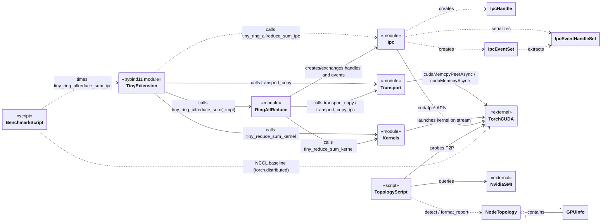

# TinyNCCL

TinyNCCL 是一个用于学习 NCCL 与分布式集合通信的轻量实现：单机多卡、基于 CUDA IPC 的 Ring AllReduce。对外以 PyTorch C++ 扩展 `tiny` 暴露，内部由 `ipc` / `transport` / `kernels` / `ring_allreduce` 四个模块协作完成。

---

## 1. Data types

### C++ 侧（`src/ipc.h`）

| 类型 | 说明 |
|------|------|
| `IpcHandle` | 单个 rank 的 CUDA IPC 显存句柄：`cudaIpcMemHandle_t mem_handle`、`void* base_ptr`、`size_t size`、`int device` |
| `IpcEventSet` | 单 rank 的本地 IPC 事件集合：`init_ready`、`reduce_scatter_done` 及其 IPC handle、`device` |
| `IpcEventHandleSet` | 可跨进程交换的事件句柄集合（不含本地 `cudaEvent_t`） |

### Python 侧（`scripts/topology.py`）

| 类型 | 说明 |
|------|------|
| `GPUInfo` | 单张 GPU 的信息：`index`、`name`、`memory_gb`、`sm_capability` |
| `NodeTopology` | 整机拓扑：`gpus: list[GPUInfo]`、`p2p_matrix: dict`、`topo: list[list[str]]` |

### Torch 侧

| 类型 | 说明 |
|------|------|
| `torch::Tensor` | 所有 C++ 接口的入参/出参张量类型；核心只支持 `float32` CUDA 张量 |

---

## 2. Classes

### `IpcHandle` （C++ struct）

```cpp
cudaIpcMemHandle_t mem_handle;   // CUDA IPC 显存句柄
void*              base_ptr;     // 本 rank 的原始指针（用于校验）
size_t             size;         // buffer 字节数
int                device;       // buffer 所在 GPU device
```

### `IpcEventSet` （C++ struct）

```cpp
cudaEvent_t          init_ready;              // 首次同步事件
cudaEvent_t          reduce_scatter_done;     // 每一步同步事件
cudaIpcEventHandle_t init_ready_handle;       // 可交换句柄
cudaIpcEventHandle_t reduce_scatter_done_handle;
int                  device;
```

### `IpcEventHandleSet` （C++ struct）

```cpp
cudaIpcEventHandle_t init_ready_handle;
cudaIpcEventHandle_t reduce_scatter_done_handle;
int                  device;
```

### `GPUInfo` （Python dataclass）

```python
index: int
name: str
memory_gb: float
sm_capability: str
```

### `NodeTopology` （Python dataclass）

```python
gpus: list[GPUInfo] = field(default_factory=list)
p2p_matrix: dict = field(default_factory=dict)       # {(i, j): bool}
topo: list[list[str]] = field(default_factory=list)  # nvidia-smi topo -m
```

### `TinyExtension`（PyTorch 扩展模块 `tiny`，由 `PYBIND11_MODULE` 注册）

不是 C++ 类，而是对外的模块边界；其方法见第 4 节。

```python
tiny_reduce_sum(dst, a, b) -> None
tiny_copy_peer(dst, src) -> None
tiny_ring_allreduce_sum(sendbuffs, recvbuffs) -> None
tiny_ring_allreduce_sum_ipc(my_rank, world_size, sendbuff, recvbuff, ipc_dir) -> None
```

---

## 3. Functions

### `ipc.h` / `ipc.cu`

```cpp
// 句柄创建与交换
IpcHandle ipc_create_handle(void* ptr, size_t size, int device);
void      ipc_save_handle(const IpcHandle& handle, const std::string& path);
IpcHandle ipc_load_handle(const std::string& path);
void*     ipc_open_handle(const IpcHandle& handle, int local_device);
void      ipc_close_handle(void* mapped_ptr);
std::vector<IpcHandle> ipc_exchange_handles(
    int my_rank, int world_size,
    void* my_ptr, size_t my_size, int my_device,
    const std::string& ipc_dir);

// 事件创建、交换与打开
IpcEventSet ipc_create_events(int device);
void        ipc_destroy_events(IpcEventSet& events);
void        ipc_save_event_handles(const IpcEventSet& events, const std::string& path);
IpcEventHandleSet ipc_load_event_handles(const std::string& path);
cudaEvent_t ipc_open_event(const cudaIpcEventHandle_t& handle, int local_device);
void        ipc_close_event(cudaEvent_t event);
std::vector<IpcEventHandleSet> ipc_exchange_event_handles(
    int my_rank, int world_size,
    const IpcEventSet& local_events,
    const std::string& ipc_dir);

// 跨进程 barrier
void ipc_barrier(
    int my_rank, int world_size,
    const std::string& ipc_dir,
    const std::string& phase, int step);
```

内部辅助（匿名命名空间）：

```cpp
bool regular_file_with_size(const std::string& path, size_t expected_size);
void wait_for_file(const std::string& path, size_t expected_size, const char* what);
```

### `transport.h` / `transport.cu`

```cpp
void transport_copy(
    void* dst, int dst_dev,
    const void* src, int src_dev,
    size_t nbytes, cudaStream_t stream);

void transport_copy_ipc(
    void* dst, int dst_dev,
    const void* src, int src_dev,
    size_t nbytes, cudaStream_t stream);
```

内部辅助：

```cpp
void  check_dev_index(int src_dev, int dst_dev);
bool  p2p_available(int src_dev, int dst_dev);
void* get_staging(int dst_dev, size_t nbytes);
void  copy_via_host(void* dst, int dst_dev, const void* src,
                    size_t nbytes, cudaStream_t stream);
```

### `kernels.h` / `kernels.cu`

```cpp
__global__ void reduce_sum_kernel(float* dst, const float* a,
                                  const float* b, int n);

void tiny_reduce_sum_kernel(
    float* dst, const float* a, const float* b,
    int n, cudaStream_t stream);
```

### `ring_allreduce.h` / `ring_allreduce.cu`

```cpp
// 单进程多 GPU 版本
void tiny_ring_allreduce_sum_impl(
    float** send, float** recv,
    size_t count, int n_gpus);

// 多进程 CUDA IPC 版本
void tiny_ring_allreduce_sum_ipc(
    int my_rank, int world_size,
    float* sendbuff, float* recvbuff,
    size_t count,
    const std::string& ipc_dir);
```

内部辅助：

```cpp
void check_cuda_ipc(cudaError_t err, const char* operation,
                    int rank, const char* phase, int step);
void log_event_result(cudaError_t err, const char* operation,
                      int rank, int step, cudaEvent_t event);
```

### `bindings.cpp`（PyTorch 扩展入口）

```cpp
void tiny_reduce_sum(torch::Tensor dst, torch::Tensor a, torch::Tensor b);
void tiny_copy_peer(torch::Tensor dst, torch::Tensor src);
void tiny_ring_allreduce_sum(std::vector<torch::Tensor> sendbuffs,
                             std::vector<torch::Tensor> recvbuffs);
void ipc_allreduce_wrapper(int64_t my_rank, int64_t world_size,
                           torch::Tensor sendbuff, torch::Tensor recvbuff,
                           std::string ipc_dir);
```

### `scripts/topology.py`

```python
def _nvidia_smi(args: list[str]) -> str
def _torch_cuda_count() -> int
def get_gpu_info() -> list[GPUInfo]
def get_topo_matrix_simple() -> list[str]
def check_p2p() -> dict[tuple[int, int], bool]
def detect() -> NodeTopology
def format_report(t: NodeTopology) -> str
def main()
```

### `scripts/benchmark.py`

```python
def parse_args() -> argparse.Namespace
def barrier(local_rank: int) -> None
def check_result(result, reference) -> bool
def run_tiny(send, rank, world, local_rank, root, warmup, iters) -> tuple[float, Tensor]
def run_nccl(send, local_rank, warmup, iters) -> tuple[float, Tensor]
def format_result(name, count, seconds, world) -> str
def main() -> int
```

### `tests/`

```python
# test_kernels.py
test_reduce_sum_scalar() / test_reduce_sum_small()
test_reduce_sum_large()  / test_reduce_sum_2d()

# test_transport.py
check_copy(src_device, dst_device, count) -> None

# test_single_process.py
run_case(count, n_gpus) -> None

# 多进程测试（torchrun）
barrier(local_rank) -> None
main() -> int
```

---

## 4. Relations


